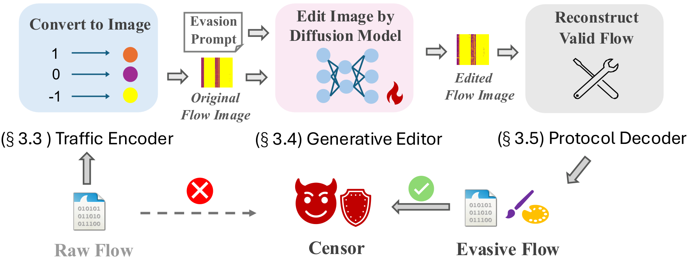

# FlowPaint

📄 **Paper:** [One-Prompt Censorship Evasion via Generative Diffusion Models](https://doi.org/10.1145/3856970), Proc. ACM Netw. 4, CoNEXT4 (CoNEXT 2026)

FlowPaint reframes censorship evasion as a semantic image-to-image editing task. It
encodes the packet headers of a network flow as an image, uses an instruction-tuned
diffusion model to repaint that image into a benign-looking flow under a single
natural language prompt, and decodes the result back into a valid, replayable PCAP.

## 📃 Overview



FlowPaint is a three-stage pipeline. Each stage is a package under `flowpaint/` and
corresponds to a section of the paper.

| Stage | Paper | Package | What it does |
|-------|-------|---------|--------------|
| Traffic Encoder | §3.3 | [`flowpaint/traffic_encoder/`](flowpaint/traffic_encoder/README.md) | PCAP → 1024-packet nPrint blocks → address masking (1088 header bits per packet) → ternary-color PNG |
| Generative Editor | §3.4 | [`flowpaint/generative_editor/`](flowpaint/generative_editor/README.md) | SDXL InstructPix2Pix U-Net fine-tuning and dual-CFG inference |
| Protocol Decoder | §3.5 | [`flowpaint/protocol_decoder/`](flowpaint/protocol_decoder/README.md) | nearest-neighbor color decoding → intra-packet repair → inter-packet restoration → flow reassembly with original payloads and recomputed checksums |

```
.
├── docs/                    # Figures used in this README
├── flowpaint/               # Core FlowPaint implementation
│   ├── traffic_encoder/     # PCAP -> nPrint -> flow image
│   ├── generative_editor/   # Fine-tuning and inference of the diffusion editor
│   └── protocol_decoder/    # Flow image -> nPrint -> repaired, replayable PCAP
├── dataset/                 # Training set construction (Geneva targets, instruction JSONL)
├── scripts/                 # End-to-end pipeline and nPrint installer
├── sample_data/             # One example training pair
├── requirements.txt
├── CITATION.cff
└── LICENSE
```

## 📚 Repository Overview

Each directory has its own `README.md` with detailed usage.

- **[`flowpaint/traffic_encoder/`](flowpaint/traffic_encoder/README.md)**: converts raw PCAP traces into flow images.
- **[`flowpaint/generative_editor/`](flowpaint/generative_editor/README.md)**: fine-tunes the SDXL InstructPix2Pix U-Net on flow-image triplets and runs instruction-guided editing.
- **[`flowpaint/protocol_decoder/`](flowpaint/protocol_decoder/README.md)**: turns an edited flow image back into a valid PCAP.
- **[`dataset/`](dataset/README.md)**: builds the training set from benign traffic and Geneva or UPGen evasive targets.
- **[`scripts/`](scripts/README.md)**: runs the whole pipeline on one PCAP.

> **Model weights are not released.** This repository contains the code only. Train
> your own Generative Editor with [`flowpaint/generative_editor/`](flowpaint/generative_editor/README.md)
> and pass the resulting checkpoint to the inference and pipeline scripts.

## ⚙️ Installation

```bash
python -m venv .venv && source .venv/bin/activate
pip install -r requirements.txt

# Build the nPrint v1.2.1 CLI used by the encoder and decoder
bash scripts/install_nprint.sh
export NPRINT_BIN="$(pwd)/third_party/nprint-1.2.1/nprint"
```

A CUDA GPU is required to fine-tune the editor and recommended for inference. The
paper used an NVIDIA RTX 5090 (32 GB).

## 🚀 Quick Start

Repaint one PCAP end to end:

```bash
python scripts/run_pipeline.py \
  --pcap flow.pcap \
  --prompt "Transform the HTTPS network traffic visualization to bypass the GFW" \
  --checkpoint /path/to/your/checkpoint \
  --work-root ./jobs
```

Without `--checkpoint` the pipeline runs as a dry run. The flow image is passed
through unedited, so the encoder and the decoder can be tested without a GPU. The
prompts used in the paper are

- `Transform the HTTPS network traffic visualization to bypass the GFW`
- `Transform the HTTPS network traffic visualization to evade Deep learning/Machine learning classifiers`

## 🔒 Scope

FlowPaint edits packet headers and the statistical fingerprint of a flow. Payload
bytes are never encoded or edited and are reattached from the original flow during
reassembly. Censors that analyze byte-level entropy or n-gram statistics of encrypted
payloads are out of scope.

## 🙏 Acknowledgements

- The nPrint image encoding and the protocol repair passes build on
  [NetDiffusion](https://github.com/noise-lab/NetDiffusion_Generator) and
  [nPrint](https://github.com/nprint/nprint).
- Fine-tuning uses the Hugging Face diffusers
  [SDXL InstructPix2Pix example](https://github.com/huggingface/diffusers/tree/main/examples/instruct_pix2pix).
- Evasive training targets come from [Geneva](https://github.com/Kkevsterrr/geneva) and UPGen.

## Ethics

FlowPaint is a research contribution to the understanding of censorship and
censorship resistance. It was evaluated in a controlled environment against locally
calibrated filters, never against live national firewalls. Use it lawfully and
responsibly.

## License

MIT, see [LICENSE](LICENSE). Third-party components keep their own licenses.

## Citation

If you use FlowPaint in your research, please cite our paper:

```bibtex
@article{ling2026flowpaint,
  author    = {Ling, Shiyi and Gan, Yuhang and Qian, Chen},
  title     = {One-Prompt Censorship Evasion via Generative Diffusion Models},
  journal   = {Proceedings of the ACM on Networking},
  volume    = {4},
  number    = {CoNEXT4},
  articleno = {56},
  month     = dec,
  year      = {2026},
  doi       = {10.1145/3856970}
}
```
